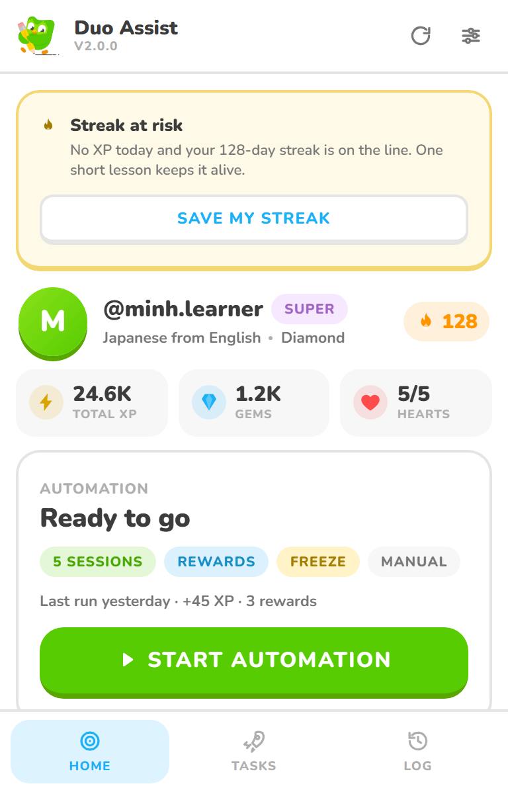
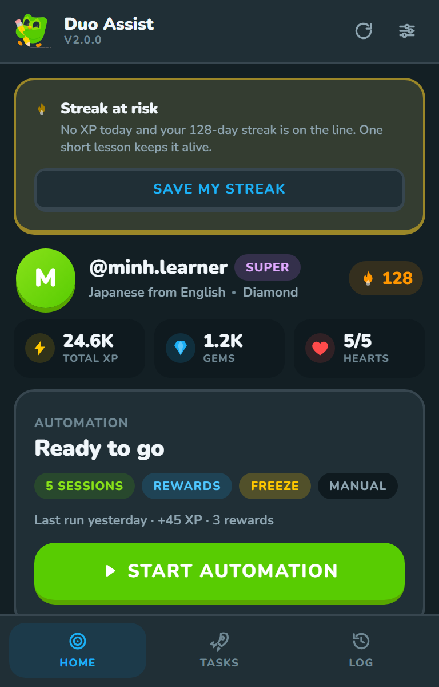
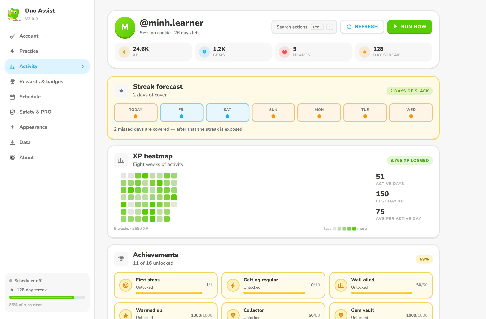
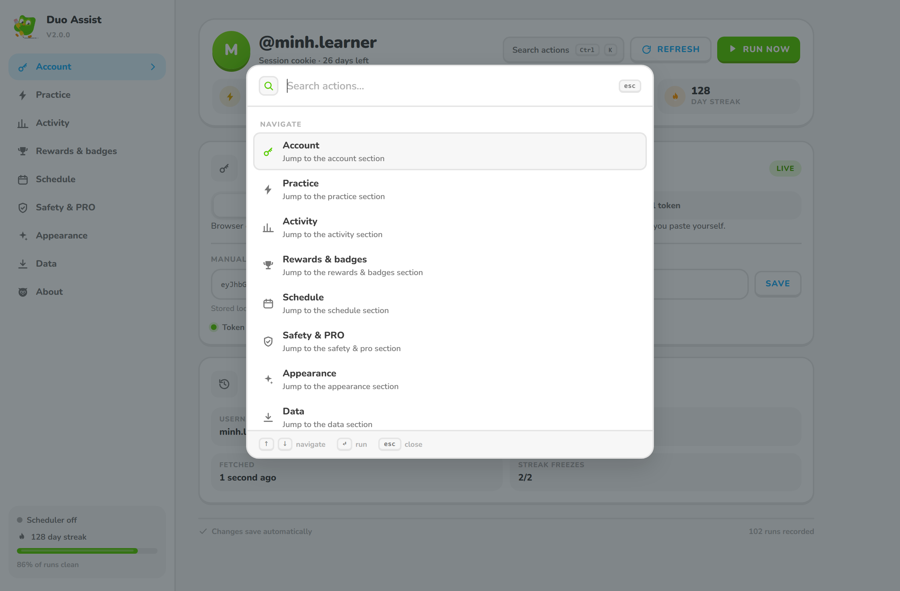
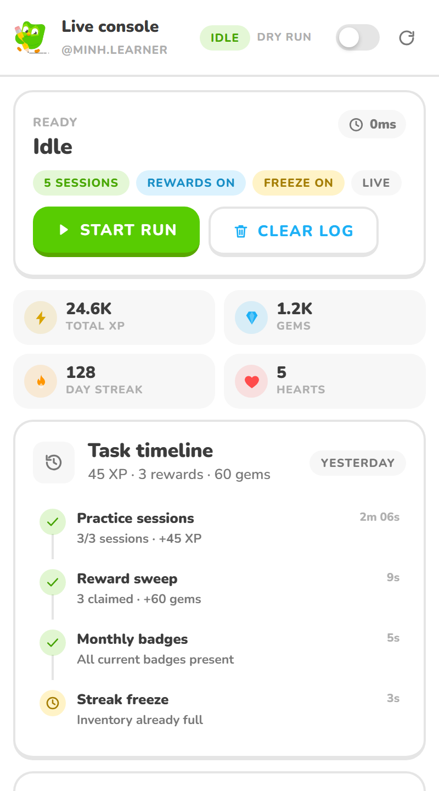
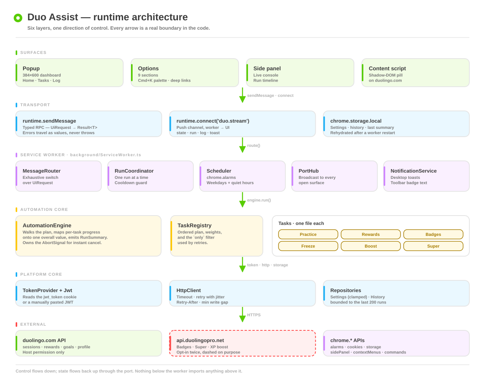
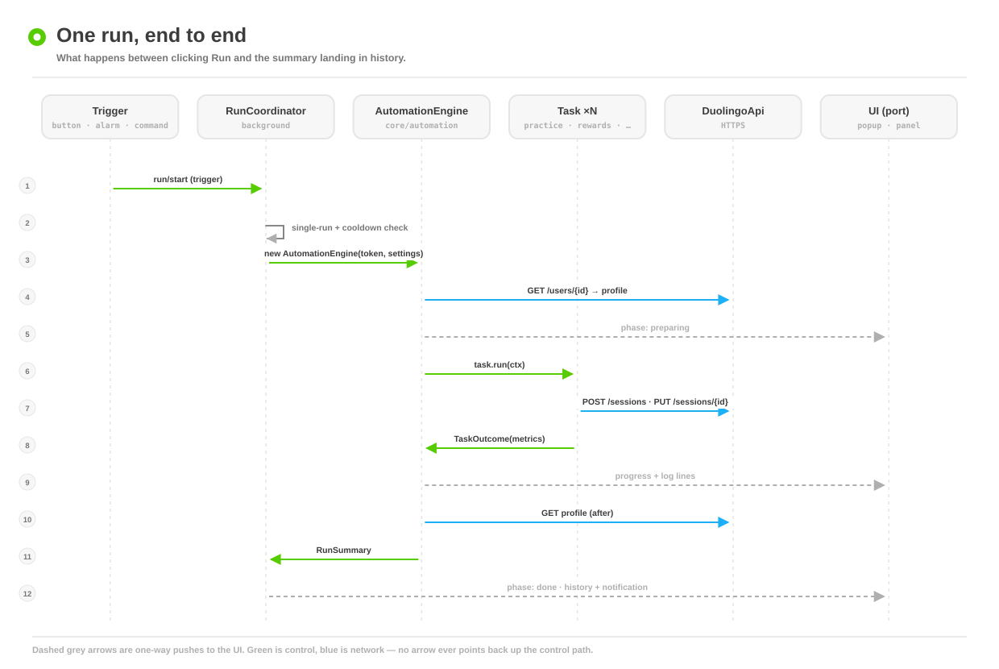
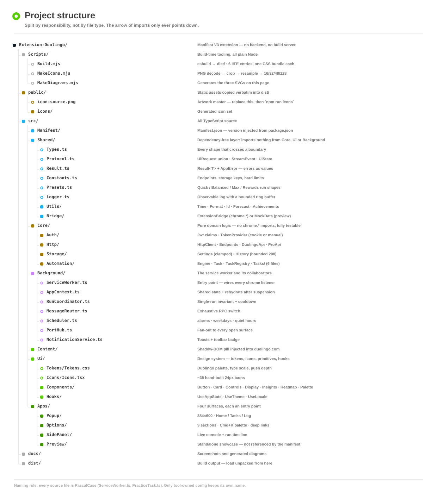

<div align="center">


# Duo Assist

**A Manifest V3 browser extension that runs your Duolingo routine for you.**

Practice sessions · reward sweeps · monthly badges · streak freezes — driven from a UI built on Duolingo's own fonts, palette and icon language. **English and Vietnamese.**

<sub>TypeScript 5.7 · React 18 · esbuild · zero runtime dependencies beyond React</sub>

</div>

---

## Contents

- [What it does](#what-it-does)
- [Surfaces](#surfaces)
- [How it works](#how-it-works)
- [One run, step by step](#one-run-step-by-step)
- [Project structure](#project-structure)
- [Install](#install)
- [Configuration](#configuration)
- [Safety model](#safety-model)
- [Scripts](#scripts)
- [Limits](#limits)
- [Testing](#testing)

---

## What it does

Six tasks run in a fixed, weighted order. Each one is a single file in `src/Core/Automation/Tasks/` and can be switched off independently.

| Task | What it does | Guard rails |
| --- | --- | --- |
| **Practice** | Opens and closes `N` sessions against `/sessions`, with a randomised duration and a randomised gap between them. | `0–30` sessions · `20–300 s` each · `0–30 s` gaps · **XP budget** stops the run the moment a ceiling is reached · **Goal mode** stops as soon as today's XP hits the daily target |
| **Rewards** | Sweeps `rewardBundles` (quests, chests, tournaments, monthly challenge) and claims each one. | `maxClaims` cap (default 35) · per-claim reporting |
| **Badges** | Reads monthly-challenge progress and reports which months are still missing. | Months that have not finished yet are ignored |
| **Freeze** | Tops up streak freezes to a target count. | Target `0–2` · HTTP `400` is read as "inventory already full", not an error |
| **Boost** | Buys Double XP with gems. | Locked behind the PRO gate |
| **Super** | Extends a Super subscription. | Locked behind the PRO gate |

### Control

| Feature | Detail |
| --- | --- |
| **Presets** | `Quick` · `Balanced` · `Max XP` · `Rewards only` — each one rewrites only the fields that define a run's shape, so your schedule and theme survive |
| **Partial runs** | Run a single task on demand, or retry *only the tasks that failed* — from the popup, the palette, or a history row |
| **Dry run** | Walks the whole plan, logs every step, and mutates nothing |
| **Cooldown** | 45 s default, blocks accidental double-clicks. Scheduled runs and targeted retries are exempt |
| **Cancel** | One `AbortSignal` threaded through the engine, the task loop and every `fetch` |
| **Adaptive throttle** | A 429 / `Retry-After` response raises the minimum mutation gap for the rest of the run, so the next request is slower |
| **Bilingual UI** | English and Vietnamese — every label, toast and log line is translated; locale switch is instant and does not reload |
| **Scheduler** | `chrome.alarms` with a 15–1440 minute interval, a weekday picker, quiet hours, run-on-startup, and an optional **streak guard** watchdog |
| **Streak guard** | A daily alarm — if today's XP is still 0 and your streak is active, it fires a minimal `Quick` plan automatically |
| **Triggers** | Button · alarm · context menu · keyboard command · the pill injected on duolingo.com |

### Observability

| Feature | Detail |
| --- | --- |
| **Streak forecast** | A deterministic model of how many missed days your freezes cover, and which day the streak becomes exposed |
| **XP heatmap** | Eight weeks of real activity, aligned to calendar weeks |
| **Achievements** | 16 specs computed as a pure function of your stats — no storage, no drift |
| **History** | Last 200 runs, each with per-task outcomes, before/after snapshots, session breakdown and a retry button |
| **Plan preview** | Shows what the next run would do right now — which tasks are enabled, what blocks the scheduler, and when the next alarm fires |
| **Weekly report** | This week vs last week — total XP, average per day, best day, goal-hit rate, with a trend indicator |
| **Export** | History and settings as JSON, straight to a file |
| **Command palette** | `Ctrl`/`⌘` + `K` — navigate, run, retry, switch theme, export |

---

## Surfaces

Four surfaces, one design system. Every colour, radius and "push" depth comes from `src/Ui/Tokens/Tokens.css`.

<table>
<tr>
<td width="50%"></td>
<td width="50%"></td>
</tr>
<tr>
<td align="center"><sub><b>Popup</b> — 384×600. Identity, run control, streak safety, fortnight chart.</sub></td>
<td align="center"><sub><b>Popup, dark</b> — every token has a Night counterpart.</sub></td>
</tr>
</table>

**Options** — nine sections, deep-linkable (`Options.html?section=activity`), with a sticky sidebar and a command palette.



**Command palette** — fuzzy search over navigation, run controls, theme and export.



**Side panel** — the live console: phase, per-task timeline and a streaming log over a `runtime.Port`.



---

## How it works

Six layers, one direction of control. Nothing below the service worker imports anything above it, and `src/Shared/` imports nothing at all.



| Layer | Responsibility |
| --- | --- |
| **Surfaces** | React apps that render state and dispatch intent. They never touch `fetch`, cookies or storage directly. |
| **Transport** | Two channels: a typed RPC (`runtime.sendMessage` → `Result<T>`) for commands, and a push channel (`runtime.connect('duo.stream')`) for state, logs and toasts. |
| **Service worker** | Routes requests, owns the single-run invariant, schedules alarms, broadcasts to every open surface, raises notifications. |
| **Automation core** | The engine, the task registry and the six tasks. Pure domain logic — it receives a token and settings, and reports outcomes. |
| **Platform core** | Token resolution (cookie or pasted JWT), the HTTP client (timeout, retry with jitter, `Retry-After`, minimum gap between mutations) and the storage repositories. |
| **External** | `duolingo.com` and, only if you opt in twice, the optional PRO bridge. |

Two rules keep the layers honest:

1. **Errors are values.** Nothing throws across a message boundary — every RPC returns `Result<T>`, so a failure is data the UI can render instead of a rejected promise it has to guess about.
2. **The worker is disposable.** Chrome kills it after 30 s of idle, so all state lives in `chrome.storage.local` and is rehydrated on every wake-up.

---

## One run, step by step



1. A trigger arrives — button, alarm, context menu, keyboard command, or the on-page pill.
2. `RunCoordinator` takes the single-run lock, checks the cooldown, and builds an `AbortController`.
3. The engine loads the profile, so it can report a before/after delta.
4. The task plan is walked in order; each task reports a `TaskOutcome`.
5. Progress and log lines stream to every open surface through the port.
6. A `RunSummary` lands in history, and a notification reports the result.

---

## Project structure

Split by responsibility, not by file type. The import arrow only ever points down.



```
src/
├── Manifest/          manifest.json — version injected from package.json at build time
├── Shared/            dependency-free layer: types, protocol, result, presets, logger, utils
│   ├── Bridge/        ExtensionBridge (chrome.*) or MockData (preview)
│   └── Utils/         Time · Format · Id · Forecast · Achievements
├── Core/              pure domain logic, no chrome.* imports, fully testable
│   ├── Auth/          Jwt · TokenProvider
│   ├── Http/          HttpClient · Endpoints · DuolingoApi · ProApi
│   ├── Storage/       StorageArea · SettingsRepository · HistoryRepository
│   └── Automation/    AutomationEngine · TaskRegistry · Tasks/ (6 files)
├── Background/        ServiceWorker + MessageRouter · RunCoordinator · Scheduler · PortHub · NotificationService
├── Content/           the pill injected into duolingo.com (Shadow DOM)
├── Ui/                design system — tokens, icons, primitives, hooks
└── Apps/              Popup · Options · SidePanel · Preview
```

**Naming rule:** every source file is PascalCase (`ServiceWorker.ts`, `PracticeTask.ts`). Only tool-owned config keeps its own convention (`package.json`, `tsconfig.json`).

| Path | Why it exists |
| --- | --- |
| `Scripts/Build.mjs` | One esbuild pass → `dist/`. Six IIFE entries, one CSS bundle each, flat output so manifest paths stay trivial. |
| `Scripts/MakeIcons.mjs` | Hand-rolled PNG decode → square crop → premultiplied resample → 16/32/48/128. No `sharp`, no canvas, no native deps. |
| `Scripts/MakeDiagrams.mjs` | Generates the three SVGs above from arithmetic, so they are reproducible and diffable. |
| `Scripts/CaptureShots.mjs` | Drives Chrome over CDP to photograph each surface at its real size, in both themes. |
| `public/icon-source.png` | Artwork master. Replace it, run `npm run icons`, done. |
| `docs/` | Generated diagrams and screenshots — not shipped in the extension. |

---

## Install

```bash
npm install
npm run build        # → dist/
```

Then in Chrome or Edge:

1. Open `chrome://extensions` and enable **Developer mode**.
2. Choose **Load unpacked** and select the `dist/` folder.
3. Pin Duo Assist, open the popup, and confirm the account card picks up your session.

`npm run dev` rebuilds on change; reload the extension card to pick it up.

**Requirements:** Chrome/Edge 114+ (or any Chromium browser with Manifest V3 and the Side Panel API).

### Connecting an account

The extension reads the `jwt_token` cookie that `duolingo.com` already sets. Two consequences worth knowing:

- You must be **signed in to duolingo.com in the same browser profile**.
- If cookies are unavailable, paste a JWT into **Options → Account**. The card shows the source and a days-left countdown either way.

---

## Configuration

Everything lives in `chrome.storage.local` under three keys: `settings`, `history`, `lastSummary`. Settings are deep-merged onto defaults on every read and every numeric field is clamped to its documented range — a corrupted blob can never put the extension into an impossible state.

| Section | Controls |
| --- | --- |
| **Account** | Token source, manual JWT, profile refresh |
| **Practice** | Sessions, session length, gaps, stop-on-error, **XP budget**, **Goal mode** |
| **Activity** | Streak forecast, heatmap, achievements, run history |
| **Rewards & badges** | Rewards sweep, claim cap, badge check, PRO bridge routing |
| **Schedule** | Interval, weekday picker, quiet hours, run on startup, **streak guard time** |
| **Safety & PRO** | Dry run, cooldown, notification toggles, the two-step PRO gate |
| **Appearance** | Theme (light/dark/system), locale (en/vi) |
| **Data** | Export history, copy settings, import, clear history, reset |
| **About** | Version, capability summary, shortcuts, links |

Keyboard shortcuts, rebindable at `chrome://extensions/shortcuts`:

| Action | Default |
| --- | --- |
| Run automation | `Alt` + `Shift` + `D` |
| Open live console | `Alt` + `Shift` + `C` |
| Command palette (in-page) | `Ctrl`/`⌘` + `K` |

---

## Safety model

Automation is inherently risky, so the risky parts are opt-in and visible rather than buried.

- **Dry run first.** The full plan executes and logs, with zero mutations. `Max` presets and first runs are worth a dry pass.
- **PRO is gated twice.** A toggle *and* an explicit "I understand the risk" checkbox. The bridge host is drawn dashed in the architecture diagram for the same reason.
- **Human-shaped timing.** Randomised session durations, randomised gaps, and a minimum 900 ms spacing between mutating requests. Evenly spaced writes are the easiest pattern to flag.
- **Adaptive throttle.** If Duolingo returns a 429, the minimum gap is raised for the rest of the run so the next batch is slower, not faster.
- **One run at a time.** The coordinator holds a lock; concurrent triggers queue instead of racing.
- **Everything is local.** No telemetry, no analytics, no account data leaves the browser except the requests Duolingo itself would receive.
- **Freezes are cheap, streaks are not.** The forecast card exists so you know exactly how many missed days you are covered for *before* you need it.

---

## Scripts

| Command | What it does |
| --- | --- |
| `npm run build` | Bundle everything into `dist/` (~1.07 MB, minified) |
| `npm run dev` | Same, in watch mode with inline sourcemaps |
| `npm run typecheck` | `tsc --noEmit`, strict |
| `npm run icons` | Rebuild the four PNG icons from `public/icon-source.png` |
| `npm run diagrams` | Regenerate `docs/diagrams/*.svg` |
| `npm run shots` | Recapture `docs/screenshots/*.png` (build first) |
| `npm run docs` | Both of the above |
| `npm run test` | Run the `node:test` suite via `tsx` (39 tests across Forecast, Settings, TaskRegistry, Achievements, Time) |
| `npm run copyright` | Stamp/verify the copyright header on every source file |
| `npm run clean` | Remove `dist/` |

The `Preview` app is not referenced by the manifest: it renders all three surfaces in a normal tab against seeded mock data, which is how the screenshots above are produced without a live account.

---

## Limits

- **Unofficial.** Not affiliated with, endorsed by, or supported by Duolingo.
- **Terms of service.** Automation may violate them, and accounts have been restricted for less. Use it on an account you own, at a volume you would be comfortable defending.
- **Endpoints move.** The API shapes in `src/Core/Http/Endpoints.ts` are the part most likely to break first. When something starts returning `4xx`, look there.
- **No cloud sync.** By design. Settings and history are per-browser-profile.

---

## Testing

The `src/Core/` and `src/Shared/Utils/` layers are pure functions with zero `chrome.*` imports, which makes them trivially testable. The test suite uses Node's built-in `node:test` runner with `tsx` for TypeScript transpilation — no Jest, no Mocha, no extra dependencies.

| Suite | What it covers |
| --- | --- |
| `Forecast.test.ts` | Streak-safety model: tone selection, slack calculation, day-by-day coverage |
| `Settings.test.ts` | `normaliseSettings` clamping, deduplication, defaults, schema migration |
| `TaskRegistry.test.ts` | `planFor` — enabled filtering, narrowed plans, `isEnabled` bypass on `only` |
| `Achievements.test.ts` | Achievement computation and summary stats |
| `Time.test.ts` | `dayKey`, `formatDuration`, `isWithinQuietHours`, wrap-past-midnight logic |

```bash
npm test              # → 39 tests, ~2s
```

<div align="center">
<sub>Built to be read as much as run — every layer above has a single, obvious reason to exist.</sub>
</div>
